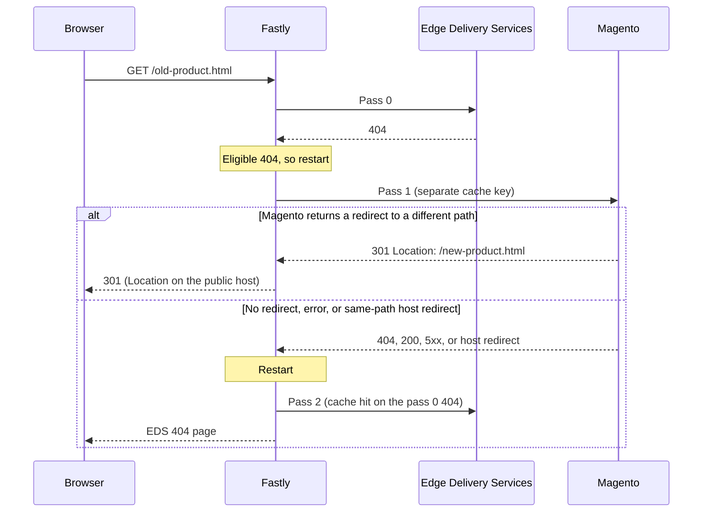

# EDS-to-Magento redirect lookup for Adobe Commerce on Cloud

Fastly VCL snippets that keep Magento as the source of truth for legacy URL redirects on an Adobe Commerce Storefront powered by Edge Delivery Services (EDS).

When EDS returns a 404 for a legacy URL, Fastly asks Magento whether a URL rewrite exists for that path. If Magento answers with a redirect, the visitor gets the redirect. If not, the visitor gets the EDS 404 page. Fastly caches both answers, so repeat requests don't reach EDS or Magento.

These snippets apply to Adobe Commerce on Cloud (PaaS), where Fastly sits in front of both EDS and Magento. They don't apply to Adobe Commerce as a Cloud Service (ACCS). See [Not for Adobe Commerce as a Cloud Service](#not-for-adobe-commerce-as-a-cloud-service).

## Contents

- [Why](#why)
- [How it works](#how-it-works)
- [Design decisions](#design-decisions)
- [Requirements](#requirements)
- [Install](#install)
- [Configuration](#configuration)
- [Operations](#operations)
- [Debugging](#debugging)
- [Testing checklist](#testing-checklist)
- [Troubleshooting](#troubleshooting)
- [Known limitations](#known-limitations)
- [Not for Adobe Commerce as a Cloud Service](#not-for-adobe-commerce-as-a-cloud-service)
- [References](#references)

## Why

Moving a Magento storefront to EDS often means carrying over a large set of legacy redirects. Magento stores them as URL rewrites: some created by hand, many created automatically when a product or category URL key changes. Large catalogs can have hundreds of thousands. In one migration, about 197,000 distinct URLs received a redirect in 90 days of traffic.

The obvious places to move them don't fit:

| Option | Limit |
|---|---|
| EDS redirect sheet | 100,000 redirects per site ([aem.live limits](https://www.aem.live/docs/limits)) |
| Fastly edge dictionaries | 1,000 items per dictionary by default ([Fastly VCL limits](https://www.fastly.com/documentation/reference/vcl/constraints-and-limitations)) |

Asking Magento only when EDS can't serve a URL avoids moving the redirects at all:

- **No export or sync.** Redirects stay in Magento, and the team keeps managing them in the Commerce Admin, including automatic rewrites when a URL key changes.
- **EDS always wins.** The lookup only runs when EDS returns a 404. A page published in EDS at a legacy URL is served directly, which supports a gradual migration.
- **Magento is asked once per URL, not per visitor.** Answers are cached at the edge.

Adobe documents a very similar pattern for failing over from EDS to Luma pages on a 404, in the [Commerce Storefront CDN configuration](https://experienceleague.adobe.com/en/tools/commerce-storefront/setup/configuration/content-delivery-network/) guide. These snippets apply the same technique to redirects only.

## How it works

Each request makes up to three passes through the Fastly service. A "pass" here means one run through the VCL; the second and third are triggered by `restart`.



| Pass | `req.restarts` | `X-Redirect-Lookup` | Backend | Cache key |
|---|---|---|---|---|
| 0 | 0 | not set | EDS | Normal (URL and host) |
| 1 | 1 | `magento` | Magento | Normal plus `redirect-lookup` |
| 2 | 2 | `final` | EDS | Normal (finds the 404 cached in pass 0) |

### What gets cached

| Object | Cache key | Edge TTL | Cleared by |
|---|---|---|---|
| EDS 404 | Normal | Set by EDS | EDS purge when a page is published at that URL |
| Magento redirect | Lookup | 3600s (browsers: 300s) | Purging surrogate key `redirect-lookup`, or TTL |
| Magento "no redirect" (404, 200, or same-path host redirect) | Lookup | 600s | Purging `redirect-lookup`, or TTL |
| Magento 5xx | Lookup | 30s | Purging `redirect-lookup`, or TTL |

Once the cache is warm, every pass is a cache hit and neither EDS nor Magento is contacted. A connection failure to Magento isn't cached; the visitor gets the EDS 404 and the next request tries Magento again.

### The snippets

| File | Type | Priority | Job |
|---|---|---|---|
| `snippets/redirect_lookup_recv.vcl` | recv | 110 | Routes pass 1 to Magento; re-enables clustering on restarted passes |
| `snippets/redirect_lookup_hash.vcl` | hash | 10 | Gives pass 1 its own cache key |
| `snippets/redirect_lookup_fetch.vcl` | fetch | 20 | Labels and caches Magento's answer |
| `snippets/redirect_lookup_deliver.vcl` | deliver | 40 | Decides when to restart and what to serve |
| `debug/redirect_lookup_debug_recv.vcl` | recv | 111 | Optional: clears the debug trace |
| `debug/redirect_lookup_debug_deliver.vcl` | deliver | 35 | Optional: records each pass in `X-RL-Trace` |

## Design decisions

Each of these came from something that didn't work during testing.

1. **Restart in `vcl_deliver`, not `vcl_fetch`.** In a Fastly POP, `vcl_fetch` can run on a different server from the one handling the client ("clustering"). A restart from there loses any request headers set before it. Fastly's [clustering guide](https://www.fastly.com/documentation/guides/full-site-delivery/custom-vcl/clustering) recommends restarting in `vcl_deliver` for this reason. An earlier version restarted in `vcl_fetch` and lost the lookup marker.

2. **A separate cache key for the Magento lookup.** Restarting in `vcl_deliver` means the EDS 404 gets cached. Without its own key, the lookup for that URL would find the cached EDS 404 and never reach Magento. `redirect_lookup_hash.vcl` adds `redirect-lookup` to the key for pass 1 only.

3. **Clustering back on for restarted passes.** Fastly turns off clustering after a restart, so the lookup and final passes would only use the cache on one server instead of the whole POP. Setting `Fastly-Force-Shield: 1` turns it back on (the header is unrelated to shielding despite its name). This is safe because pass 1's fetch only changes the response, and all decisions are made in `vcl_deliver`.

4. **The marker header is only trusted on our own restarts.** `X-Redirect-Lookup` is cleared on every client request (`req.restarts == 0`), so a client can't send it to force a Magento lookup.

5. **`vcl_fetch` labels, `vcl_deliver` decides.** The fetch snippet sets `X-Redirect-Result` on the cached response. Response data survives clustering; request changes made in `vcl_fetch` don't.

6. **Only redirects that change the path count.** With Magento's **Auto-redirect to Base URL** turned on, Magento returns a 302 to the same path on its base-URL host for any request on another host. That's not a URL rewrite. Caching it would send every 404 to the wrong host, so the fetch snippet treats a same-path redirect as "no redirect".

7. **`Location` is rewritten to the public host.** Magento builds redirect targets from its base URL, which on Adobe Commerce on Cloud can be an origin hostname ending in `.magento.cloud`. The fetch snippet replaces those hosts with the host the visitor used.

8. **Only eligible 404s trigger a lookup.** Only GET or HEAD requests whose path ends in `.html` and that aren't Commerce routes (`x-commerce` not set) are looked up. This keeps random 404s and scanners from reaching Magento.

9. **The restart budget fits.** Fastly allows three restarts per request; the fourth returns a 503 ([Fastly `restart`](https://www.fastly.com/documentation/reference/vcl/statements/restart/)). These snippets use at most two, leaving room for the default VCL's single retry on a 5xx.

10. **`Set-Cookie` and `Vary` are removed from lookup responses.** Magento sets cookies and varies responses. Without removing them, the lookup answers wouldn't be cached or would be split into many variants.

## Requirements

### Fastly

The storefront must already be set up as described in Adobe's [Commerce Storefront CDN configuration](https://experienceleague.adobe.com/en/tools/commerce-storefront/setup/configuration/content-delivery-network/) guide. These snippets rely on that setup:

- A `recv` snippet at priority 100 (`edge_delivery_recv` in the guide) that sends Commerce routes to the Commerce backend with `x-commerce: true`, and everything else to EDS.
- A `fetch` snippet at priority 30 that returns early for EDS responses.
- `miss`, `pass` and `deliver` snippets at priority 30 for the EDS backend.

### Magento

1. Set **Auto-redirect to Base URL** to **No** for the storefront's store view: **Stores → Settings → Configuration → General → Web → Url Options**. Setting it at store-view scope leaves the Admin untouched. Adobe's CDN guide also tells you to set the base URLs to your public domain.
2. Check that Magento no longer redirects the public host:
   ```bash
   curl -sI "https://{your-host}/customer/account/login/" | grep -iE '^(HTTP|location)'
   ```
   This must not return a 302 to another host with the same path.
3. Manage redirects in **Marketing → SEO & Search → URL Rewrites**, or let Magento create them automatically when a URL key changes.

## Install

1. In `snippets/redirect_lookup_recv.vcl`, replace `F_REPLACE_WITH_COMMERCE_BACKEND` with your Commerce backend: the one your `edge_delivery_recv` snippet uses for Commerce routes. The snippet won't compile until you do.
2. In `snippets/redirect_lookup_deliver.vcl`, adjust the eligibility pattern (`\.html$`) if your legacy URLs look different.
3. Add each file as a custom VCL snippet with the type and priority in [The snippets](#the-snippets). Use the Commerce Admin (**Stores → Settings → Configuration → Advanced → System → Full Page Cache → Fastly Configuration → Custom VCL Snippets**), the Fastly UI, or the Fastly API.
   - Don't rename snippets after creating them. With the Commerce Admin Fastly module, a rename creates a new snippet and leaves the old one active (see Adobe's CDN guide).
4. Look at the generated VCL and confirm that `redirect_lookup_hash` appears in `vcl_hash` before the default `return (hash);`.
5. Activate the new service version.
6. Optionally add the two debug snippets, then run the [testing checklist](#testing-checklist).

## Configuration

| Setting | File | Default |
|---|---|---|
| URLs that trigger a lookup | `redirect_lookup_deliver.vcl` | GET or HEAD, path ends in `.html`, not a Commerce route |
| Edge TTL for redirects | `redirect_lookup_fetch.vcl` | 3600s |
| Browser cache for redirects | `redirect_lookup_fetch.vcl` | `public, max-age=300` |
| Edge TTL for "no redirect" | `redirect_lookup_fetch.vcl` | 600s |
| Edge TTL for Magento 5xx | `redirect_lookup_fetch.vcl` | 30s |
| `Location` hosts rewritten to the public host | `redirect_lookup_fetch.vcl` | Hosts ending in `.magento.cloud` |

## Operations

### When redirect changes take effect

A redirect added or changed in Magento takes effect when the cached answer expires: within an hour for URLs that already redirected, and within 10 minutes for URLs that didn't. To apply it immediately, purge the `redirect-lookup` surrogate key:

```bash
curl -X POST -H "Fastly-Key: {api-token}" \
  "https://api.fastly.com/service/{service-id}/purge/redirect-lookup"
```

The Fastly API token and service ID are under **Stores → Settings → Configuration → Advanced → System → Full Page Cache → Fastly Configuration** in the Commerce Admin.

The purge clears every cached lookup answer and leaves EDS content alone. Afterwards, Magento is asked again once per URL per POP.

### Publishing an EDS page at a legacy URL

When EDS publishes a page at a URL that used to return 404, EDS's push invalidation purges the cached 404. The next request is served by EDS and no lookup happens.

### Monitoring Magento load

Each Magento lookup shows up as a Magento request. In New Relic:

```
SELECT count(*) FROM Transaction
WHERE request.uri = '/old-product.html'
SINCE 1 hour ago
```

With a warm cache, expect about one request per URL per POP per TTL period.

## Debugging

The two snippets in `debug/` add an `X-RL-Trace` response header with one entry per pass. They only run when the request sends `Fastly-Debug: 1` or `X-Redirect-Test`. Anyone who sends one of those headers can see the trace, so leave the debug snippets out of production, or remove them once you've finished testing.

Trace format:

```
pass=<restarts> lookup=<none|magento|final> status=<code> cache=<state> result=<label> age=<seconds>
```

`cache` is Fastly's cache state for that pass. Anything starting with `HIT` (for example `HIT` or `HIT-CLUSTER`) is a cache hit.

Run the check script:

```bash
RUNS=3 scripts/check.sh https://{your-host} /old-product.html "/rl-check-$(date +%s).html" /a-page-without-html /
```

Example trace for a cached redirect (illustrative):

```
pass=0 lookup=none status=404 cache=HIT-CLUSTER result=- age=- | pass=1 lookup=magento status=301 cache=HIT-CLUSTER result=magento-redirect age=120
```

Example trace for a cached "no redirect" (illustrative):

```
pass=0 lookup=none status=404 cache=HIT-CLUSTER result=- age=- | pass=1 lookup=magento status=404 cache=HIT-CLUSTER result=magento-miss age=45 | pass=2 lookup=final status=404 cache=HIT result=- age=-
```

## Testing checklist

Use a fresh path for "no redirect" tests. A "no redirect" answer stays cached for 10 minutes.

| Scenario | First request | Repeat requests |
|---|---|---|
| Real EDS page | 200, one pass | Cache hit |
| 404 not ending in `.html` | 404, one pass, no lookup | Cache hit |
| `.html` 404, no Magento rewrite | 404 with three passes; pass 1 `result=magento-miss` | All three passes are cache hits |
| `.html` with a Magento rewrite | 301 or 302 with `Location` on the public host; pass 1 `result=magento-redirect` | Both passes are cache hits |
| Change the rewrite, then purge `redirect-lookup` | New `Location`; pass 1 is a miss | Cache hits |
| Magento request count (New Relic) | About one per URL per POP | No increase |

## Troubleshooting

| Symptom | Likely cause | Fix |
|---|---|---|
| Every lookup shows `result=magento-host-redirect` | Magento's **Auto-redirect to Base URL** is on | Set it to No for the storefront store view |
| Pass 1 shows `status=404 result=-` | The lookup found the cached EDS 404: `redirect_lookup_hash` isn't changing the cache key | Check that the hash snippet appears before `return (hash);` in the generated VCL |
| Pass 1 alternates between `HIT` and `MISS` across repeat requests | Clustering is off for restarted passes | Check the `Fastly-Force-Shield` block in `redirect_lookup_recv` |
| Only `pass=0` appears for an eligible 404 | The deliver snippet didn't run or the URL isn't eligible | Check its priority (40), the path pattern, and the request method |
| Pass 1 shows `status=503 result=-` | Magento or the WAF was unreachable | Check the Commerce backend; visitors get the EDS 404 meanwhile |
| Pass 1 shows `status=200 result=magento-miss` | Magento renders a page at that URL instead of redirecting | Expected if Magento still serves that page |
| `Location` still points at a `.magento.cloud` host | The host rewrite didn't match | Check the `Location` value Magento returns |
| `redirect_lookup_recv` won't compile | Backend placeholder not replaced | See [Install](#install) step 1 |

## Known limitations

- **Query strings are dropped.** The standard EDS `recv` snippet removes the query string before routing, so redirects lose parameters such as `utm_*`.
- **Purging is all or nothing.** All lookup answers share one surrogate key. Per-URL purging would need a per-URL key.
- **First request per URL per POP is slower.** It waits for EDS and Magento before the answer is cached.
- **Long-term dependency on Magento.** Legacy redirects work only while Magento keeps running and keeps its URL rewrites.
- **The default eligibility only covers `.html` URLs.** Other legacy URL shapes need a different pattern.

## Not for Adobe Commerce as a Cloud Service

This approach depends on Magento being reachable behind the storefront CDN and answering storefront URLs. ACCS doesn't provide that:

- ACCS doesn't support Luma storefronts ([ACCS overview](https://experienceleague.adobe.com/en/docs/commerce/cloud-service/overview)).
- The URL Rewrites tool and the GraphQL `route` query are marked PaaS-only ([search-term redirects guide](https://experienceleague.adobe.com/en/docs/commerce-admin/marketing/seo/search-term-redirects), [`route` query](https://developer.adobe.com/commerce/webapi/graphql/schema/products/queries/route)).
- Adobe says PaaS URL rewrites don't transfer automatically to ACCS and should be added to the EDS redirect sheet ([Commerce Storefront SEO indexing](https://experienceleague.adobe.com/en/tools/commerce-storefront/setup/seo/indexing/)).
- ACCS storefronts use an Adobe-managed CDN by default; you can bring your own ([Commerce Storefront CDN configuration](https://experienceleague.adobe.com/en/tools/commerce-storefront/setup/configuration/content-delivery-network/)).

On ACCS, the options are to fit redirects within the EDS redirect sheet (prune and use CDN pattern rules), or to bring your own CDN and look redirects up in an edge key-value store using the same restart pattern.

## References

- [Commerce Storefront CDN configuration](https://experienceleague.adobe.com/en/tools/commerce-storefront/setup/configuration/content-delivery-network/) (Adobe)
- [Clustering in VCL](https://www.fastly.com/documentation/guides/full-site-delivery/custom-vcl/clustering) (Fastly)
- [`restart` statement](https://www.fastly.com/documentation/reference/vcl/statements/restart/) (Fastly)
- [HTTP caching semantics](https://www.fastly.com/documentation/guides/concepts/cache/cache-freshness/) (Fastly)
- [BYO CDN setup for Fastly](https://www.aem.live/docs/byo-cdn-fastly-setup) (aem.live)
- [aem.live limits](https://www.aem.live/docs/limits)
- [URL rewrites](https://experienceleague.adobe.com/en/docs/commerce-admin/marketing/seo/url-rewrites/url-rewrite) (Adobe Commerce)

## License

[Apache License 2.0](LICENSE)
